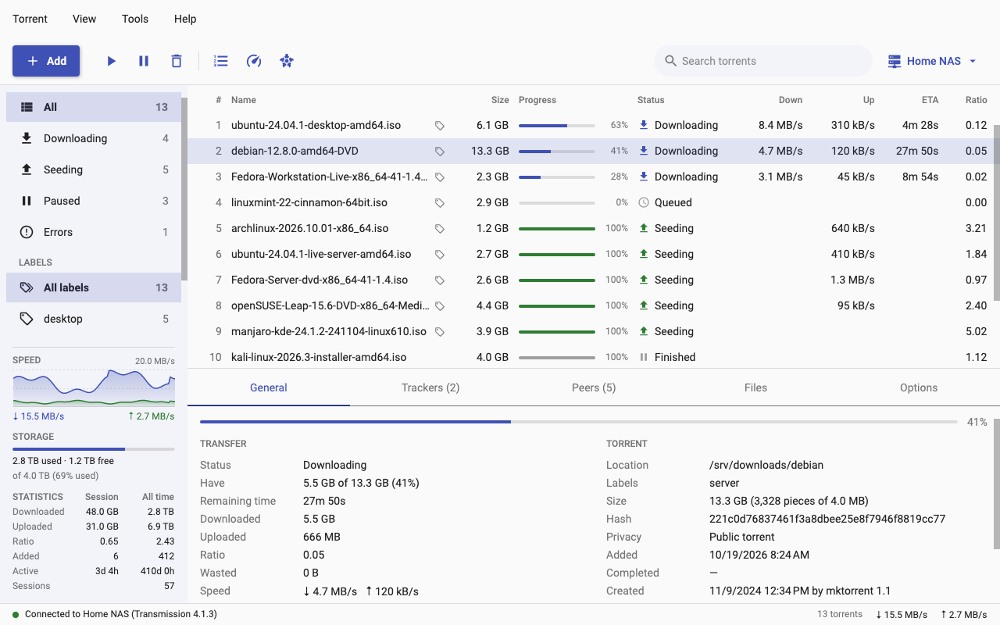
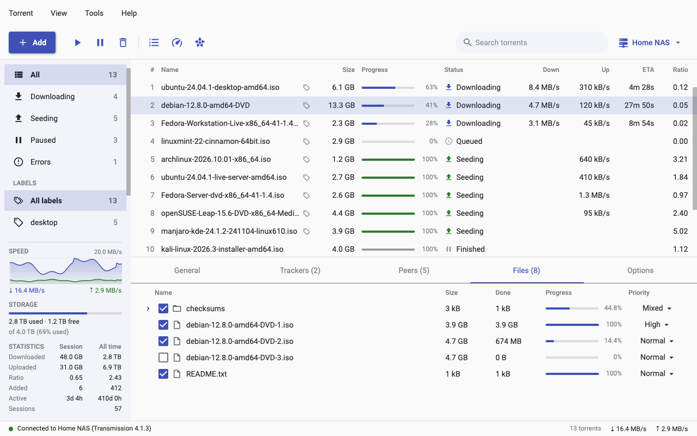
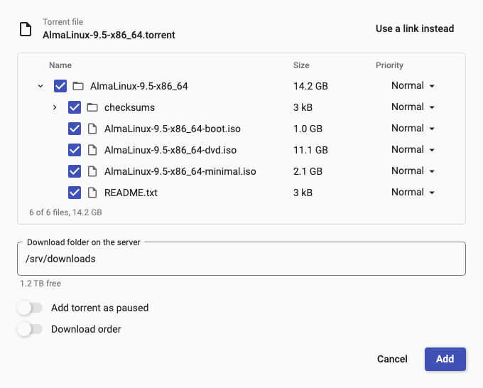
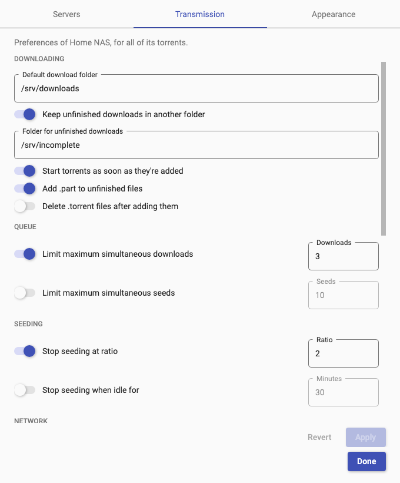

<p align="center">
  
</p>

<h1 align="center">Synchromesh</h1>

<p align="center">
  A cross-platform .NET desktop client to control a <a href="https://transmissionbt.com">Transmission</a> server.<br>
  For macOS, Windows and Linux.
</p>

<p align="center">
  <a href="https://github.com/maxxie85/synchromesh/releases/latest"></a>
  <a href="https://github.com/maxxie85/synchromesh/actions/workflows/ci.yml"></a>
  <a href="LICENSE"></a>
  
</p>

<picture>
  <source media="(prefers-color-scheme: dark)" srcset="docs/screenshots/main-dark.png">
  
</picture>

Control your Transmission server from a familiar desktop client.
Implements most of the RPC API. Currently supported: RPC 6.0.0, JSON-RPC 2.0. By default, communication uses the gzipped transport to reduce traffic.

By default, Synchromesh stores server credentials in the macOS Keychain, Windows Credential Manager or the Linux keyring.
If desired, you can choose to store the credentials in an encrypted file, with the possibility of a master password.

> A *synchromesh* is a brass ring that synchronises the speed between two different gears in a transmission.
> Synchromesh is an independent project, not affiliated with the Transmission project.

## Features

**Torrent overview.** The overview updates every two seconds. Filter by
status or by labels, search by name, and:
- change the queue order
- start
- stop
- verify
- re-announce
- move or delete torrents, one at a time or many at once.

**Torrent details.**
The details panel shows general information, the tracker list, the peer list, the file list and per-torrent options.

<picture>
  <source media="(prefers-color-scheme: dark)" srcset="docs/screenshots/files-dark.png">
  
</picture>

**Add torrents.**
Synchromesh supports the following ways to add new torrents:
- drag and drop a `.torrent` file on the window
- paste a magnet link
- open `.torrent` files and `magnet:` links from your browser or file manager (Synchromesh registers as their handler)

Before the download starts, pick the files you want, their priority, the folder on the
server, and whether to download in order.

<p align="center">
  <picture>
    <source media="(prefers-color-scheme: dark)" srcset="docs/screenshots/add-dark.png">
    
  </picture>
</p>

**Settings.**
Switch between several servers. Set speed limits and flip the
alternative-speed "turtle" with one click. Modify the server's preferences (folders, queues, seeding, peers,
encryption, the blocklist) and check whether its port is open.

The sidebar shows the total speed over the last
minutes, the free space on the server's disk, and transfer statistics.

<p align="center">
  <picture>
    <source media="(prefers-color-scheme: dark)" srcset="docs/screenshots/settings-dark.png">
    
  </picture>
</p>

**Additional features.**
- Notifications when a download finishes or a torrent runs into an error.
- Choose between light, dark or system theme.
- Native menus and keyboard shortcuts.
- HTTPS and client certificate support.

## Download

Get the latest version from the [releases page](https://github.com/maxxie85/synchromesh/releases/latest):

| System | Download | |
|---|---|---|
| macOS 13 or newer, Apple Silicon | `Synchromesh-<version>-macos-arm64.dmg` | Open it and drag Synchromesh to Applications. |
| Windows 10 or 11, x64 or ARM64 | `Synchromesh-<version>-windows-<arch>-setup.exe` | Run it; it installs for your user, no administrator rights needed. |
| Linux, x64 or ARM64 | `Synchromesh-<version>-linux-<arch>.tar.gz` | Unpack it and run `./install.sh` in the folder. |

The apps aren't signed yet, so the first start needs one confirmation:

- **macOS** stops the app the first time. Open it once, then go to System Settings > Privacy & Security and click
  **Open Anyway**. To open `.torrent` files with it, use Get Info on a `.torrent` file in Finder > Open with >
  Change All. Your browser asks which app should open magnet links.
- **Windows** SmartScreen may warn about an unknown app: click **More info**, then **Run anyway**. If another app
  already opens `.torrent` files or magnet links, choose Synchromesh in Settings > Apps > Default apps.
- **Linux:** the installer adds Synchromesh to your application menu and registers it for `.torrent` files and
  magnet links. To remove it, run `~/.local/share/nl.vinch.synchromesh/uninstall.sh`. It needs an X11 or Wayland
  desktop. Most distributions have everything else; minimal ones may lack `libicu`, `libfontconfig` or `libsecret`.

## Requirements

- **Transmission 4.1 or newer** on the server, with remote access (RPC) turned on. Synchromesh speaks Transmission's
  modern JSON-RPC 2.0 interface; older versions use a different protocol and aren't supported as of now.

## Where your data is kept

| | macOS | Windows | Linux |
|---|---|---|---|
| Servers and settings | `~/Library/Application Support/Synchromesh/` | `%APPDATA%\Synchromesh\` | `~/.config/Synchromesh/` |
| Passwords | Keychain | Credential Manager | Keyring (Secret Service) |

The server list (`profiles.json`) never contains passwords. If you choose Synchromesh's own password file in
Settings > Servers, the passwords are encrypted in `passwords.json` (AES-256-GCM) with a key in `passwords.key`,
next to the settings, both readable only by you. That protects them if the file is copied on its own. Add a master
password to also protect them from other programs you run: the key is then encrypted with it, and Synchromesh asks
for it once each time it starts.

## Building from source

You need the [.NET 10 SDK](https://dotnet.microsoft.com/download).

```bash
git clone https://github.com/maxxie85/synchromesh.git
cd synchromesh
dotnet run --project src/Synchro.Desktop
```

Contributions are welcome: see [CONTRIBUTING.md](CONTRIBUTING.md).
[docs/development.md](docs/development.md) covers the tests, packaging for each platform, releases and how the code
is organised. What changed in each version is in the [changelog](CHANGELOG.md).

## License

Synchromesh is open source under the [MIT license](LICENSE). It includes open-source components under their own
licenses, listed in [THIRD-PARTY-NOTICES.txt](THIRD-PARTY-NOTICES.txt) and in the app under About > License texts.
